# Learning log van Plamedie

## Practicum mooie kleuren en gradients

## Mini styleguide

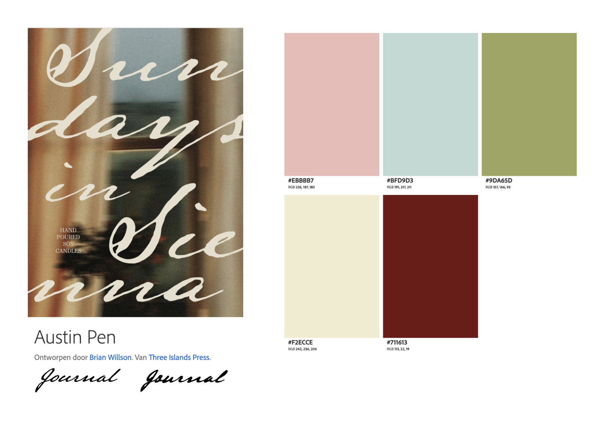

## Mobile-first schetsen

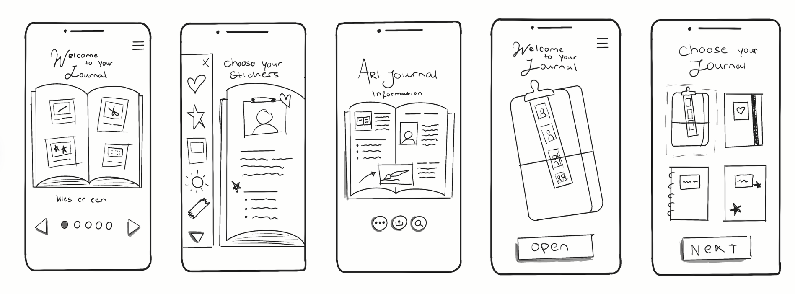

## Schetsoefening Crazy 8

Mijn uitgangspunt is om een Digital Garden te maken die voelt als een persoonlijk scrapbook. Ik wil werken met een speelse en nostalgische stijl, waarbij foto's, collages, gescheurd papier en verschillende vormen terugkomen.

In mijn schetsen experimenteer ik met verschillende indelingen, fotokaders, stickers en decoratieve elementen. Ik wil dat de website creatief en persoonlijk aanvoelt, alsof je door iemands journal bladert.

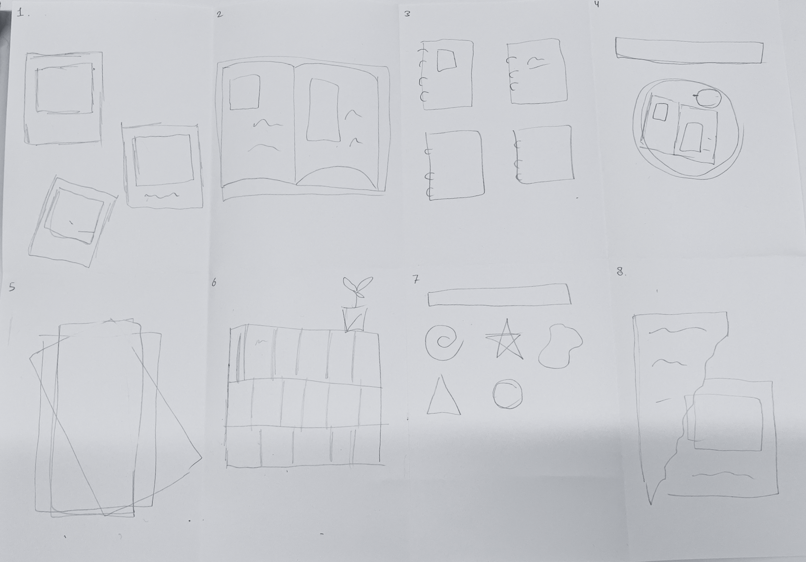

## Visual research

### Stap 3 - Uitgangspunten voor schetsen

Tijdens deze opdracht heb ik geleerd om beter naar typografie te kijken en te herkennen hoe lettertypes, kleuren en vormen samen een bepaalde sfeer creëren. Ik heb vier beelden gekozen die passen bij mijn sfeerwoorden speels en nostalgisch.

Waar ik tegenaan liep, was het vertalen van de inspiratie naar concrete ontwerpkeuzes. Ik moest goed kijken welke onderdelen ik zelf zou willen gebruiken.

Wat ik meeneem, is het combineren van verschillende lettertypes, collages, foto's en vormen om mijn ontwerp persoonlijker te maken.

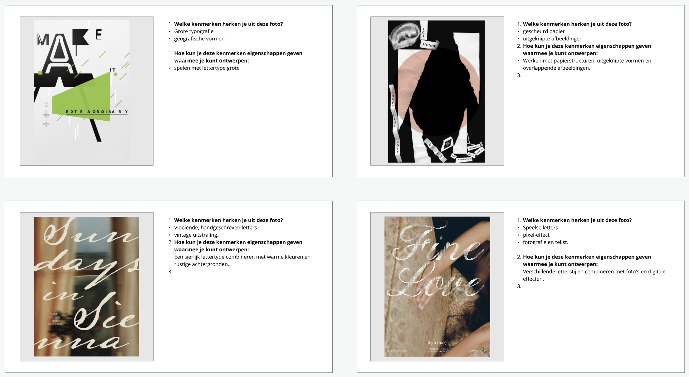

### Stap 2 - Abstracte vertaling

Wat mij opvalt is dat er veel verschillende lettertypes worden gebruikt. sommige zijn groot en opvallend, terwijl andere juist sierlijk en speels zijn. Dit past bij de sfeerwoorden omdat, het een creative en vintage uitstraling geeft
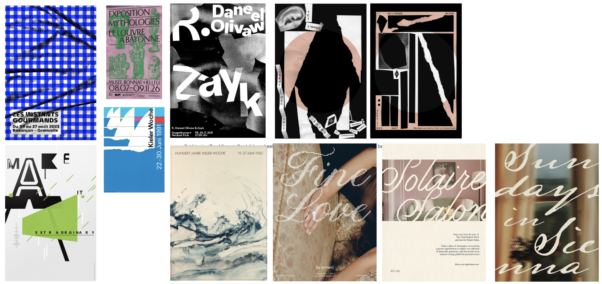

### Stap 1 - Directe visuele vertaling

Ik heb de sfeerwoorden **speels en nostalgisch** gekozen omdat, ik een creatieve en warme sfeer creëren, alsof je door een persoonlijke journal vol herinneringen bladert, met speelse elementen

**Zie je patronen in je verzameling?:**

Ik ziel veel vintage en scrapbook-elementen, zoals foto’s, stickers, collages, handgeschreven teksten. De kleuren zijn vooral beige, lichtblauw, groen en bruin met roze en geel als accenten.

**Wat kun je beschrijven als kenmerken die passen bij je sfeerwoord en je gevonden beelden?:**

Mijn sfeerwoorden zijn **speels en nostalgisch**. Dit zie ik terug in de creatieve collages, oude foto's en persoonlijke details.

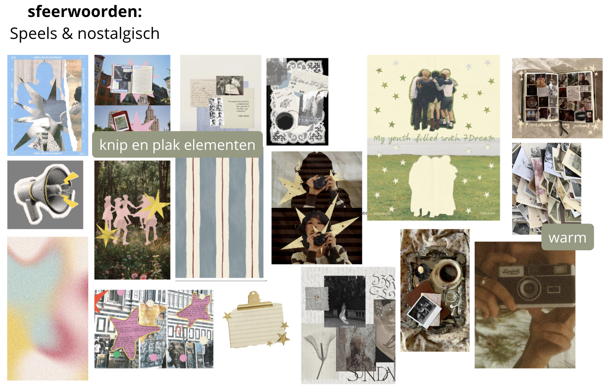

## Checkout 16.11.'26

1. **Leg uit wat een digital garden is en waarom dat anders is dan een reguliere website.**

een digital garden anders werkt dan een gewone website of sociale media. Je kunt zelf bepalen hoe je informatie indeeldt, verbanden legt en steeds nieuwe dingen toevoegt. Het hoeft niet perfect te zijn, maar kan steeds blijven groeien en veranderen

1. **Leg uit wat een website 'webby' maakt en welke websites jou het meeste inspireren.**

Een website is webby als deze creatief, interactief en verrassend is. Ik vond vooral **tamaNOTchi.world** inspirerend door de speelse uitstraling, persoonlijke elementen en interacties.

1. **Vertel waar jij mee aan de slag wilt gaan bij het maken van jouw eigen digital garden (let op: dit zijn jouw eerste ideeën, dit kan en mag veranderen in de loop van het programma.**

Ik wil een Digital Garden maken over journalen. Met een scrapbook-achtige huisstijl wil ik verschillende journalstijlen laten zien, inspiratie delen en bezoekers zelf onderdelen laten personaliseren.

## Verkenning onderwerp

### Opdracht 3 – verzamelen van inspiratie

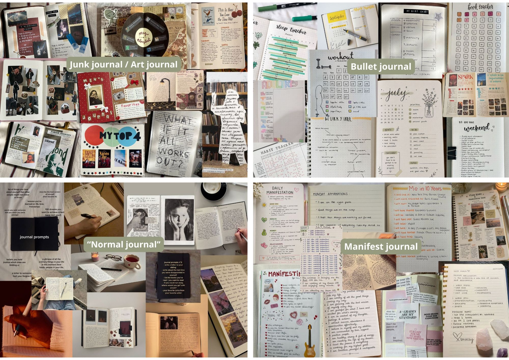

### Opdracht 2 – Eigen verkenning

#### **Digital garden - journal**

**Mijn concept:**

Ik wil een digital garden maken over journalen. Ik wil verschillende stijlen uitleggen en ervan laten zien.

Qua huisstijl wil ik een creative knip-en-plakstijl gebruiken, aslof je door een echte journal of scrapbook bladert.

**Wat wil ik maken?:**

- Een website met een scrapbook uitstraling
- pagina’s met verschillende journalstijlen
- inspiratie, voorbeelden en tips

**Welke webby elementen wil ik gebruiken?**

- Focus en hover state
- Light en dark mode
- Adaptief maken
- expessief

**Welke eigen content wil ik maken? + Gebruik van content van anderen**

Ik journal zelf ook dus wil graag mijn eigen journal gebruiken voor foto’s en inspiratie

Ik wil Pinterest en andere journalwebsites gebruiken als inspiratie. Ik neem geen teksten of afbeeldingen zomaar over, maar geef er mijn eigen draai aan door zelf foto's, layouts en voorbeelden te maken. Bij materiaal van anderen let ik op auteursrechten en bronvermelding.

**Hoe wil ik mijn content laten ervaren?**

- **Zien:** Foto's, collages, stickers en voorbeelden.
- **Lezen:** Informatie, tips en journal prompts.
- **Doen:** Kleuren kiezen, stickers verplaatsen en moodboards maken.
- **Ontdekken:** Verschillende journalstijlen bekijken.
- **Ervaren:** Het gevoel krijgen dat je door een echt scrapbook bladert.

### Opdracht 1 – Rangschikken

Tijdends het onderzoeken van welke webiste meer webby is kwamen we er achter dat mijn groepje de tamanotchi webiste leuker vonden omdat het ook beter scoorde bij de catagorie, expressief en leuk en verassend. Daardoor was de website persoonlijker en unieker.

De website van het andere tweetal scoorde beter bij toegankelijk en interactief/dynamischer

**Wat ik heb geleerd:** Dat een website niet alleen gebruiksvriendelijk hoeft te zijn, maar ook een eigen karakter en uitstraling kan hebben.

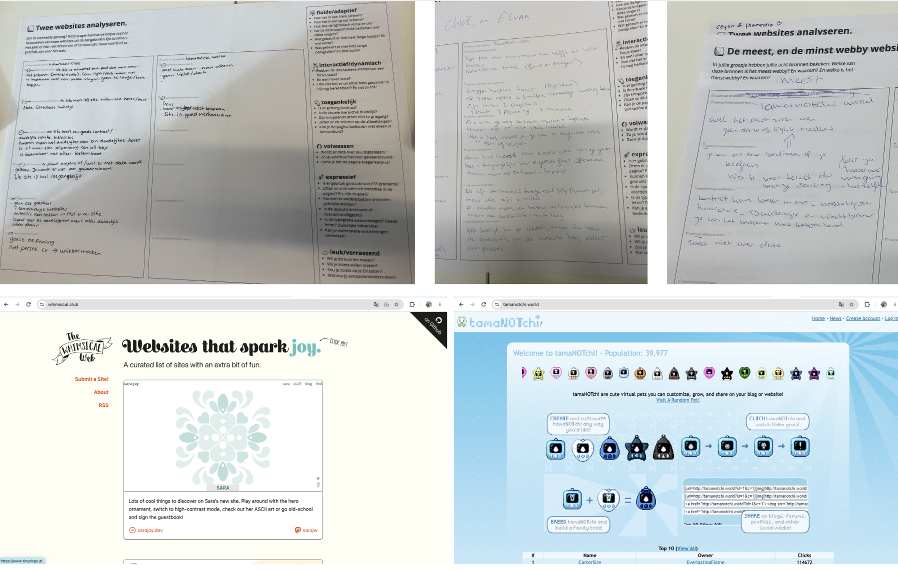

## Sprintplanning

**Belangrijkste inzichten - The garden and the stream**

- **The garden** = een website waar alles met elkaar is verbonden. Bezoekers kunnen zelf rondkijken en hun eigen route bepalen (aan de garden zit **geen** tijd aan vast)
- **The stream** = meer als sociale media zoals instagram, tiktok en facebook. Waar je dus updates krijg, de de info volgt elkaar op en verdwijnt weer. (aan sociale media zit **wel** tijd aan vast)
- **Digital garden:** die hoeft dus geen vaste vogorde te hebben. Je kunt steeds nieuwe info toevoegen, aanpassen en uitbreiden

Ik heb geleerd dat een digital garden anders werkt dan een gewone website of sociale media. Je kunt zlef bepalen hoe je informatie indeeldt, verbanden legt en steeds nieuwe dingen toevoegt. Het hoeft niet perfect te zijn, maar kan steeds blijven groeien en veranderen

**Dit neem ik mee:** Mijn eigen website creatief en persoonlijk maken, zodat bezoekers zelf kunnen ontdekken en rondkijken

## Practica 4: Schetsen van o.a. interactie en animatie 13.11.'26

### Challenge2 - Schets de animaties en interactie

Tijdens deze oefening heb ik geleerd hoe je animaties op verschillende manieren kunt weergeven in een schets. Bijvoorbeeld door stippellijnen te gebruiken, een onderdeel uit te vergroten of pijlen te tekenen om te laten zien dat iets beweegt of ergens inschuift.

Deze technieken heb ik vervolgens toegepast op mijn Wok to Walk-schets. Hiermee kan ik duidelijker laten zien hoe bepaalde elementen reageren en welke bewegingen er in het ontwerp plaatsvinden.

Wat ik hiervan meeneem, is dat je met simpele tekentechnieken al goed kunt uitleggen hoe een animatie of interactie werkt.

#### Conclusie:

Ik heb geleerd hoe ik animaties duidelijker kan schetsen, zodat anderen beter begrijpen hoe mijn ontwerp werkt.

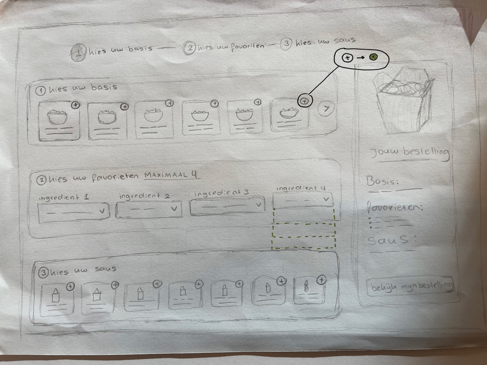

### Challenge 1 - mi-fi

Voor deze opdracht heb ik een low-fi schets gemaakt van de Pinterest-homepage. Hierbij heb ik de technieken uit de vorige schetsoefening toegepast, zoals het gebruik van schaduwen, strakkere lijnen en duidelijke vormen.

Ik heb geleerd hoe je met deze technieken een schets netter en duidelijker kunt maken. Waar ik op moest letten, was vooral de indeling van de afbeeldingen en de ruimte tussen de verschillende elementen.

Wat ik hiervan meeneem, is dat kleine details, zoals schaduwen en duidelijke lijnen, ervoor zorgen dat een low-fi schets beter te begrijpen is.

#### Conclusie:

Ik heb de technieken uit de vorige opdracht kunnen toepassen en merk dat ik hierdoor bewuster en duidelijker kan schetsen.
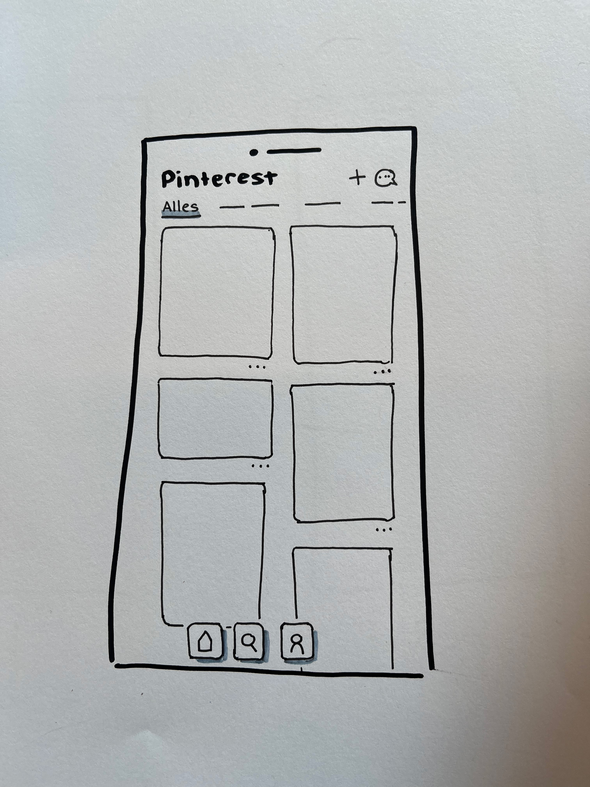

### Opdracht - Schetsen

Tijdens deze tek en schetsoefeningen heb ik geleerd hoe ik mijn schetsen netter en duidelijker kan maken. Zo helpt het bij het tekenen van lange, rechte lijnen om naar het eindpunt te kijken. Ook werkt het beter om een vierkant met vier losse lijnen te tekenen in plaats van één doorlopende lijn.

Daarnaast heb ik geleerd dat je bij low-fi schetsen beter de afbeelding zelf kunt tekenen in plaats van alleen een kruis te gebruiken. Schaduwen kunnen helpen om knoppen, pop-ups en inputvelden duidelijker te maken. Ook is het handig om annotaties een andere kleur te geven, zodat ze beter opvallen.

Wat ik hiervan meeneem, is dat kleine details mijn schetsen duidelijker en overzichtelijker kunnen maken.

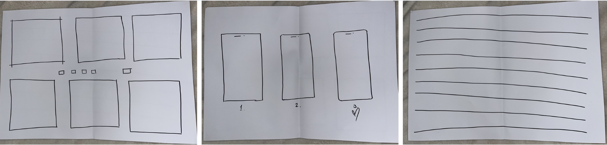

#### Conclusie:

Door deze oefeningen heb ik geleerd om bewuster te schetsen en meer aandacht te besteden aan details, duidelijkheid en afwerking.

### Opdracht - rangschrikken

Als eerst hebben we rangschrik oefening gedaan. Hieruit kwam uit dat goede schetsten bestaan uit:

- Annotaties: Uitleg toevoegen over je schets
- compact: Niet te veel onnodige tekst erbij
- Variatie: verschillende ideeën en richtingen proberen
- Accentkleur: kleur gebruiken om belangrijke onderdelen uittelichten
- Duidelijke richting: laten ziet wat het idee of doel is van je schets

#### Conclusie:

Door deze oefening weet ik beter waar ik op moet letten bij het maken van mijn eigen schetsen en hoe ik mijn ideeën duidelijker kan presenteren.

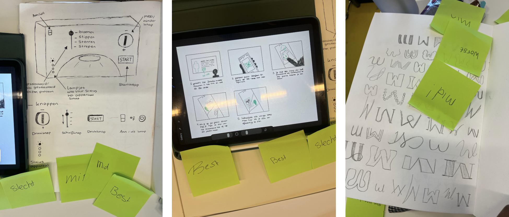

## Practica 3: Interactie: MMD, micro-interacties, forms 13.11.'26

### Opdracht

De vragen:

**1. De context (wat komen mensen doen?)**

Mensen komen bij wok to walk om snel hun eigen maaltijd samen te stellen. Ze willen zelf kiezen wat erin komt en niet te lang wachten

Het moet dus snel te gebruiken, duidelijke keuzes, stap voor stap en dus voor een lapto/ipad

**2. De verdeling van de content**

Ik zou het formulier verdelen in vier duidelijke stappen:

1. Kies je basis
2. kies je ingrediënten
3. kies je saus
4. Controleer de bestelling → bestellen

Zo blijft het overzichtelijk en hoeft de klant niet alles tegelijk te bekijken

**3. Wat maakt het verrassend/leuk**

ik zou het formulier wat interactiever maken door voorbeelden te laten zien, feedback dus als als je op een knop drukt.

Voor deze opdracht heb ik een schets gemaakt. Ik heb het formulier in drie stappen: je basis, je ingrediënten en je saus. Aan de rechterkant heb ik een overzicht van de bestelling toegevoegd zodat je meteen ziet wat je hebt gekozen.

Tijdens het schetsen heb ik geleerd hoe belangrijk het is om de content logisch te verdelen en het bestelproces overzichtelijk te houden.

Waar ik tegen aan liep, was vooral hoe ik alle keuzes op een scherm logisch kon verdelen zonder dat het te druk zou worden.

Wat ik meeneem is dat het handig is om met duidelijke stappen te werken, zo weet de gebruiker precies waar die is en wat er nog moet gebeuren.

#### Conclusie:

Met deze schets heb ik een eerste idee uitgewerkt voor een gebruiksvriendelijk bestelformulier. In de volgende stap wil ik kijken hoe ik dit verder kan verbeteren en visueel kan uitwerken

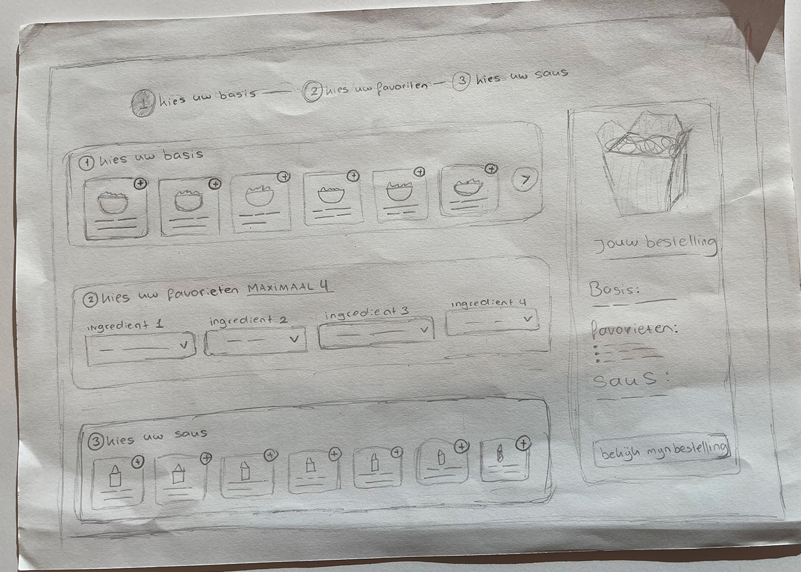

## Practica 2: CSS: fonts met kleur en effecten 11.11.'26

### Opdracht

Tijdens deze css-oefening heb ik geleerd hoe je met @font-face een eigen lettertype aan je website kan toevoegen. Ook heb ik geoefend met het aanpassen van letters , zoals de grootte, dikte en kleur. Daarnaast kwam ik er weer achter hoe je verschillende font-weight gebruikt, bijvoorbeeld 400 voor normaal en 700 voor bold.

Waar ik tegenaan liep was vooral het begrijpen hoe je het lettertype goed koppelt aan je css-code dus moet daarmee oefeningen

Wat ik hiervan meeneem, is dat ik nu weet hoe ik zelf lettertypes kan toevoegen en aanpassen om mijn website een eigen uitstraling te geven.

#### Conclusie:

Het was een handige oefening om meer controle te krijgen over de typografie en vormgeving van mijn website

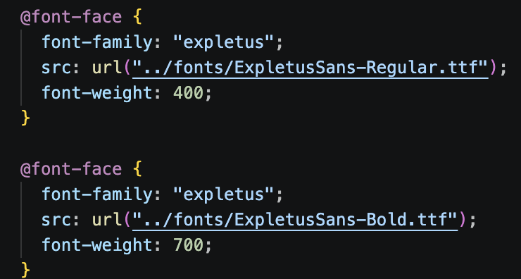 

### voorbereiding

Hiervoor heb ik intro over web safe fonts gelezen.
Wat ik heb geleerd, is dat je niet zomaar elk lettertype kunt gebruiken. Je moet rekening houden met de beschikbaarheid, bestandsgrootte en eventuele licenties.

- **Web-safe fonts:** Standaard beschikbaar op bijna alle apparaten.
- **Web font services:** Niet toegestaan voor deze opdracht.
- **@font-face:** Hiermee kun je eigen lettertypen toevoegen.
- **Bestandsgrootte:** Te veel fonts kunnen je website trager maken.
- **Licenties:** Niet ieder lettertype is gratis.

Wat ik hiervan meeneem, is dat ik bewust wil kiezen welke lettertypen ik gebruik en dat ik met `@font-face` meer vrijheid heb in mijn vormgeving.

## Practica 1: Praktische CSS 11.11.'26

### Opdracht

Tijdens deze les hebben we de lijke html-pagina met CSS vormgegeven.

Ik heb geleerd dat een website een maximale regellengte kan hebben (max-width: 50ch;), zodat teksten prettiger leesbaar blijven. ook heb ik geleerd dat het beter om lange teksten/broodtekst het beste links uitgelijnd kan zijn. Daarnaast ook dat je met de (cursor: pointer; ) ervoor kunt zorgen dat je bij buttons de muis ziet als je over de buttons heen gaat.

Waar ik ook meer over heb geleerd, zijn de verschillende buttons states ook in css kan aangeven zoals, hover, active, visites en focus. Hiermee kun je de website ook meer toegankelijk maken

Wat ik hiean meeneem, is dat css niet alleen bedoeld is om een website mooier te maken, maar ook om de gebruiksvriendelijkheid en leesbaarheid te verbeteren.

#### Conclusie:

Ik heb geleerd om beter na te denken over de vormgeving en toegankelijkheid van een website. Deze CSS-technieken kan ik ook gebruiken bij mijn eigen Digital Garden.

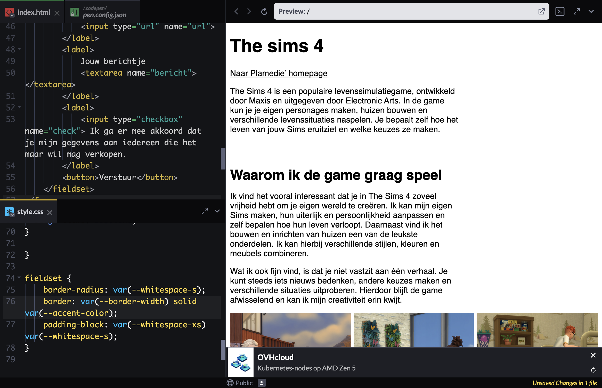

### voorbereiding

Tijdens deze opdracht heb ik de code van DLO gekopieerd en mijn eigen content ingevuld en ben ik zelf gaan kijken wat de verschillende tags ook alweer doen. Ik merkte dat de meeste kennis een beetje was weggezakt, dus heb ik weer effe gekeken in codepen hoe bepaalde dingen werken, Bijvoorbeeld ul en li voor het maken van lijstjes, hoe je afbeeldingen toevoegt en hoe je een blockquote maakt. Het was zeker een goede opfrisser om mijn basic html kennis weer op t halen.

Deze dingen neem ik zeker mee bij het verder maken van mijn digital garden
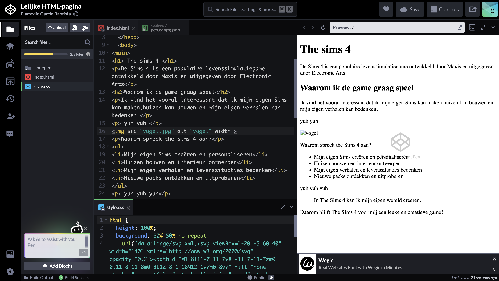

Tijdens deze opdracht heb ik de CSS Game gespeeld om meer te leren over de CSS-selectors. In het begin vind ik het best verwarrend en lastig om de juiste selector te benoemen. Na een tijdje begon het wat makkelijker te gaan, maar de levels werder ook steeds moelijker. Door de frustratie ben ik helaas niet verder gekomen dan level :(.

Ik heb geleerd wat een CSS-selector is (bepaal je welke html-element je wilt aanpassen) en hoe ik deze in de code kan benoemen en gebruiken. wat ik meeneem, is dat hier nog meer wil oefenen zodat ik er handiger in word
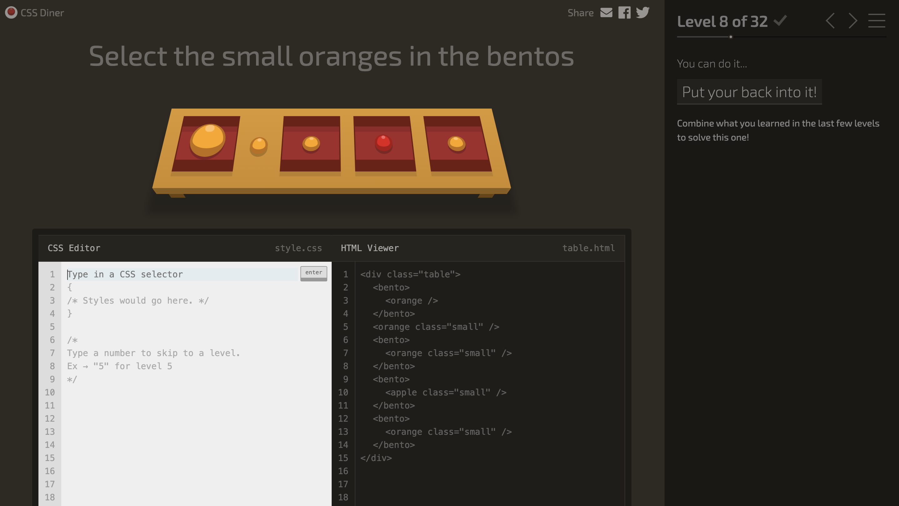

## Checkout 09.11.'26

**Vraag 1: Leg uit wat een source hosting platform is en voor welke jij gekozen hebt.**
Een source hosting platform is een online plek waar je code en bestanden kan bewaren.

Ik heb voor de source hosting platform Github gekozen omdat, ik hier eerder mee heb gewerkt in het eerste jaar. Dus was hier al een beetje bekend mee hoe het werkt.

**Vraag 2: Vertel welke domeinnaam jij gekozen hebt en hoe je die hebt gekoppeld aan jouw pagina.**
Ik heb als domeinnaam mijn volledige naam omdat, het makkelijk/simpel te onthouden is voor mij en stel ik wil mijn domein hosting verlengen dat is dat zit ik bijvoorbeeld niet vast aan dit project met een specifieke naam.

Hoe ik dit heb gekoppeld aan mijn pagina is dat ik eerst via github pages mijn website online heb gezet en daarna via transIP een domeinnaam heb geclaimed en gekoppeld met github.

**Vraag 3: Beschrijf hoe je aanpassingen aan jouw pagina kunt maken en hoe je er voor zorgt dat die op het web gepubliceerd worden.**
Ik kan de aanpassingen aan mijn pagina kan maken is om de code te bewerken in VSCodium en daarna github weer live zetten.

#### Conclusie:

Tijdens deze opdracht heb ik weer geleerd over githu, github pages en het koppelen van mijn eigen domeinnaam via Transip. Ik vond het ook fijn om de opdracht met een klasgenoot te bespreken en te zien hoe iemand anders ermee aan de slag gaat. Als tip kraag ik om een om digitaaltuintje.nl te kijken voor inspo en te zien wat andere cmd studenten hebben gemaakt
