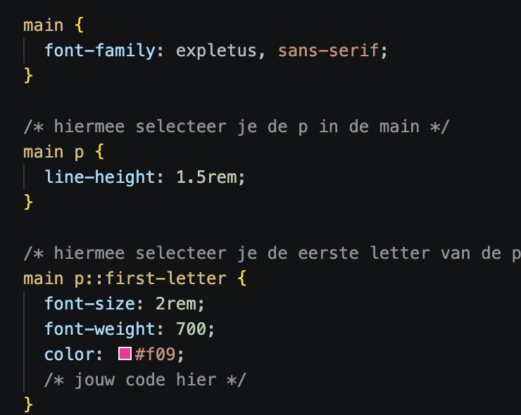
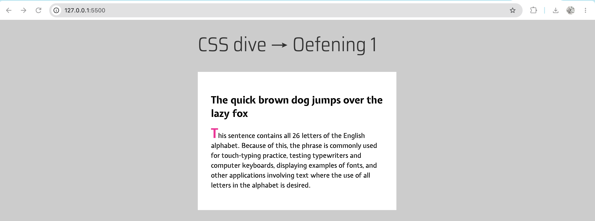

# Learning log van Plamedie

## Checkout 16.11.'26

### Opdracht 2 – Eigen verkenning

### Opdracht 1 – Rangschikken

## Verkenning onderwerp

## Sprintplanning

## Practica 4: Schetsen van o.a. interactie en animatie 13.11.'26

## Practica 3: Interactie: MMD, micro-interacties, forms 13.11.'26

## Practica 2: CSS: fonts met kleur en effecten 11.11.'26

### Opdracht

 

### voorbereiding

Hiervoor heb ik intro over web safe fonts gelezen.
Wat ik heb geleerd, is dat je niet zomaar elk lettertype kunt gebruiken. Je moet rekening houden met de beschikbaarheid, bestandsgrootte en eventuele licenties.

- **Web-safe fonts:** Standaard beschikbaar op bijna alle apparaten.
- **Web font services:** Niet toegestaan voor deze opdracht.
- **@font-face:** Hiermee kun je eigen lettertypen toevoegen.
- **Bestandsgrootte:** Te veel fonts kunnen je website trager maken.
- **Licenties:** Niet ieder lettertype is gratis.

Wat ik hiervan meeneem, is dat ik bewust wil kiezen welke lettertypen ik gebruik en dat ik met `@font-face` meer vrijheid heb in mijn vormgeving.

## Practica 1: Praktische CSS 11.11.'26

### Opdracht

Tijdens deze les hebben we de lijke html-pagina met CSS vormgegeven.

Ik heb geleerd dat een website een maximale regellengte kan hebben (max-width: 50ch;), zodat teksten prettiger leesbaar blijven. ook heb ik geleerd dat het beter om lange teksten/broodtekst het beste links uitgelijnd kan zijn. Daarnaast ook dat je met de (cursor: pointer; ) ervoor kunt zorgen dat je bij buttons de muis ziet als je over de buttons heen gaat.

Waar ik ook meer over heb geleerd, zijn de verschillende buttons states ook in css kan aangeven zoals, hover, active, visites en focus. Hiermee kun je de website ook meer toegankelijk maken

Wat ik hiean meeneem, is dat css niet alleen bedoeld is om een website mooier te maken, maar ook om de gebruiksvriendelijkheid en leesbaarheid te verbeteren.

#### Reflectie:

Ik heb geleerd om beter na te denken over de vormgeving en toegankelijkheid van een website. Deze CSS-technieken kan ik ook gebruiken bij mijn eigen Digital Garden.

### voorbereiding

Tijdens deze opdracht heb ik de code van DLO gekopieerd en mijn eigen content ingevuld en ben ik zelf gaan kijken wat de verschillende tags ook alweer doen. Ik merkte dat de meeste kennis een beetje was weggezakt, dus heb ik weer effe gekeken in codepen hoe bepaalde dingen werken, Bijvoorbeeld ul en li voor het maken van lijstjes, hoe je afbeeldingen toevoegt en hoe je een blockquote maakt. Het was zeker een goede opfrisser om mijn basic html kennis weer op t halen.

Deze dingen neem ik zeker mee bij het verder maken van mijn digital garden

Tijdens deze opdracht heb ik de CSS Game gespeeld om meer te leren over de CSS-selectors. In het begin vind ik het best verwarrend en lastig om de juiste selector te benoemen. Na een tijdje begon het wat makkelijker te gaan, maar de levels werder ook steeds moelijker. Door de frustratie ben ik helaas niet verder gekomen dan level :(.

Ik heb geleerd wat een CSS-selector is (bepaal je welke html-element je wilt aanpassen) en hoe ik deze in de code kan benoemen en gebruiken. wat ik meeneem, is dat hier nog meer wil oefenen zodat ik er handiger in word

## Checkout 09.11.'26

**Vraag 1: Leg uit wat een source hosting platform is en voor welke jij gekozen hebt.**
Een source hosting platform is een online plek waar je code en bestanden kan bewaren.

Ik heb voor de source hosting platform Github gekozen omdat, ik hier eerder mee heb gewerkt in het eerste jaar. Dus was hier al een beetje bekend mee hoe het werkt.

**Vraag 2: Vertel welke domeinnaam jij gekozen hebt en hoe je die hebt gekoppeld aan jouw pagina.**
Ik heb als domeinnaam mijn volledige naam omdat, het makkelijk/simpel te onthouden is voor mij en stel ik wil mijn domein hosting verlengen dat is dat zit ik bijvoorbeeld niet vast aan dit project met een specifieke naam.

Hoe ik dit heb gekoppeld aan mijn pagina is dat ik eerst via github pages mijn website online heb gezet en daarna via transIP een domeinnaam heb geclaimed en gekoppeld met github.

**Vraag 3: Beschrijf hoe je aanpassingen aan jouw pagina kunt maken en hoe je er voor zorgt dat die op het web gepubliceerd worden.**
Ik kan de aanpassingen aan mijn pagina kan maken is om de code te bewerken in VSCodium en daarna github weer live zetten.

#### Reflectie

Tijdens deze opdracht heb ik weer geleerd over githu, github pages en het koppelen van mijn eigen domeinnaam via Transip. Ik vond het ook fijn om de opdracht met een klasgenoot te bespreken en te zien hoe iemand anders ermee aan de slag gaat. Als tip kraag ik om een om digitaaltuintje.nl te kijken voor inspo en te zien wat andere cmd studenten hebben gemaakt
